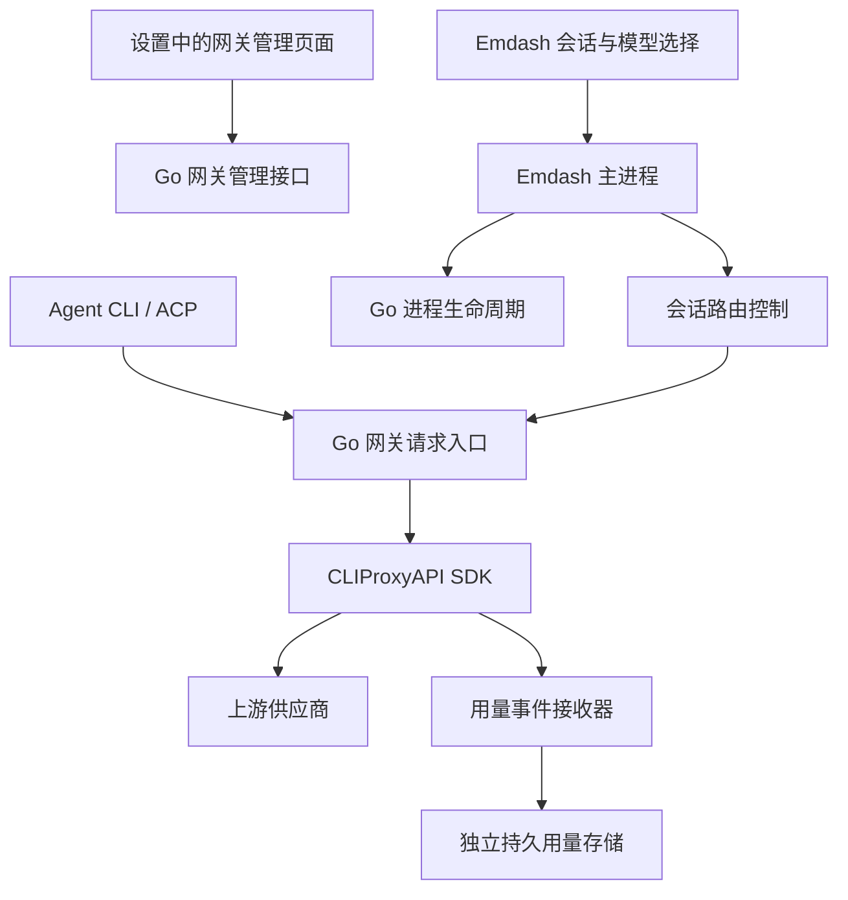

# Emdash 内嵌 Go 模型网关方案

状态：已实现统一供应商设置和默认启动的本地路由，支持 Responses、Chat Completions、Anthropic Messages 三种协议。CLI、ACP、原生设置页和独立用量链路已通过本地验证。真实 OAuth 授权与刷新尚待本人登录验收。

最新方案与交付边界见 [实施记录](embedded-go-gateway-implementation.md)。

**2026-11-15 调整：复用原来的 Providers 原生页面，取消独立网关页面与上游管理网页。供应商配置只有一份；本地新选择默认经过路由，远程连接和已有直连会话保留原路径。** 下文的初版执行计划作为历史记录，其中嵌入网页与仅支持 Codex 的描述已由此调整替代。

原型验证见 [SDK 接入验证](embedded-go-gateway-validation.md)。

## 1. 目标与使用场景

在 Emdash 中随应用运行一个 Go 网关，复用 CLIProxyAPI SDK 的供应商接入能力，
并在设置中嵌入其配套供应商管理 UI。

用户在同一个 Codex 会话中从供应商 A 切换到 B 后，希望保留会话和上下文，
其他并行会话继续使用自己的供应商。用户删除聊天记录后，用量统计仍应保留。

共同原则是：Agent 面向稳定的网关入口，供应商选择由会话路由决定。
Emdash 继续负责会话、MCP、Skills、指令和 Agent hooks。

## 2. 已确定的范围

| 项目 | 决定 |
| --- | --- |
| 宿主应用 | 保留 Electron、React 和 TypeScript 架构 |
| 网关运行方式 | Go 子进程随应用运行，由 Emdash 管理生命周期 |
| 供应商协议接入 | 优先复用 CLIProxyAPI SDK，避免自行维护全部协议 |
| 供应商管理 UI | 在设置中增加独立的网关页面，嵌入配套管理 UI |
| 会话路由 | 会话独立绑定供应商，切换不影响其他会话 |
| 用量采集 | 优先消费 SDK 用量事件，不读取聊天文件计算 |
| 持久用量 | 独立保存，删除聊天不级联删除统计 |
| 本地内容脱敏 | 暂不实现，已有日志密钥保护仍保留 |
| 费用估算 | 暂不纳入第一版 |
| MCP、Skills、指令、Agent hooks | 复用 Emdash 已有能力 |
| 记忆与经验沉淀 | 后续单独设计，不纳入网关第一版 |

## 3. 已有基础与证据边界

Emdash 已有模型供应商、官方账号、模型选择、额度查询和启动配置注入。
相关接入点包括：

- `apps/emdash-desktop/src/core/features/model-providers/`
- `apps/emdash-desktop/src/core/features/model-providers/api/node/source-launch.ts`
- `apps/emdash-desktop/src/core/features/model-providers/node/effective-agent-config.ts`
- `packages/plugins/src/agents/impl/codex/`
- `packages/core/src/runtimes/acp/`

已有隔离原型位于
`apps/emdash-desktop/tooling/prototypes/go-gateway/`。
它用本地 mock 上游验证了稳定 provider 标识下切换路由、会话隔离和独立用量文件。
根目录原型尚未连接桌面应用；其下的 `sdk-v8-validation/` 已接入固定 SDK，
验证模拟供应商下的 HTTP 路由与实际 Codex CLI 续聊。
真实供应商和官方订阅账号的完整授权仍未验证。

稳定 provider 标识解决的是原型中验证的 provider 身份限制。
它不保证任意模型之间都能无损续聊：工具调用、推理内容、压缩记录、
服务端响应 ID 和上下文窗口仍需要逐项验证。历史会话迁移也未验证。

## 4. 架构与职责



这里的 SDK 是网关 SDK。第一版沿用 Emdash 的 CLI／ACP 运行路径，
不因引入网关而更换为 Codex 或 Claude 的 Agent SDK。

| 功能 | 负责方 | 边界 |
| --- | --- | --- |
| 网关供应商、账号、模型映射编辑 | 配套管理 UI 和网关配置服务 | 网关配置是这些记录的唯一编辑来源 |
| 原生 Agent 登录 | Emdash 原有入口 | 与经网关接入的账号明确区分 |
| 凭据保存 | Emdash secret 服务与 Go 存储适配 | 网关配置只存引用，完整实现按 10.4 验证 |
| OAuth 和 Token 刷新 | 优先复用 SDK | 逐家验证登录、刷新和保存流程 |
| 请求执行、流式响应、协议转换 | SDK | Emdash 验证支持的能力组合 |
| 模型发现 | SDK 提供数据，Emdash 展示 | 不把模型列表等同于完整能力声明 |
| 会话供应商和模型选择 | Emdash | 读取网关目录，写入会话路由 |
| 会话路由和切换时机 | Emdash 与 Go 网关 | 不使用全局默认供应商切换影响全部会话 |
| 重试、限流、账号选择 | 受约束地复用 SDK | 只在明确配置的范围内执行 |
| 用量采集 | SDK | 可用字段取决于上游和适配器 |
| 用量持久化 | Go outbox 与 Emdash 账本 | 与聊天删除、网关重启解耦，详见 10.8 |
| 订阅剩余额度 | Emdash 额度服务或验证后的上游接口 | 不能由请求 token 数直接推算 |
| MCP、Skills、指令、Agent hooks | Emdash | 不引入第二套管理系统 |

SDK 的生命周期钩子和用量回调属于网关内部扩展点，
与 Emdash 用来接收 Agent 工作、完成、权限状态的 hooks 分属不同层。

## 5. 设置页面与配置归属

设置增加独立的网关页面，承载配套供应商管理 UI。
聊天界面继续使用 Emdash 的供应商和模型选择器，从网关获取目录和状态。

建议随应用打包管理 UI 的固定版本，由本地服务提供，避免运行时自动追随上游更新。
已验证的 v8 SDK commit 与配套 UI 可以连接、登录、读写管理配置，
并在独立 Electron WebContentsView 中打开供应商和 OAuth 页面。
供应商页面裁剪和免输入管理 Key 的认证交付仍需设计。
SDK 和管理 UI 是两个接入部分，不假设 SDK 自带可直接嵌入的页面组件。

嵌入页面不获得 Electron Node 能力或完整 preload 权限。
管理凭据不放在 URL 中，管理权限与 Agent 的请求权限分离。
承载容器优先采用隔离的 WebContentsView，启用 sandbox 和 contextIsolation，
禁用 Node 集成，不提供 Emdash preload。已测试的 `data:` 宿主页 iframe 方案
会因管理 UI 无法访问 localStorage 而失败，不能直接采用。
这项结果只覆盖该宿主来源组合；应用实际窗口的定位、焦点和销毁行为仍需验证。

网关管理页面保存成功后，Emdash 应刷新供应商目录。
如网关不可用，页面显示状态和重试入口；会话不能静默退回其他账号。

登录入口分为两条路径：原生 Agent 登录保留在 Emdash 的 Agent／官方账号管理入口；
网关 OAuth 登录放在设置中的网关页面，复用配套 UI 的授权页。
两者可并存。原生登录本身也可能使用 OAuth，区别在于账号归属和请求是否经过网关。
从原生直连切到网关时，历史会话的继续使用需要验证，不承诺两条路径无缝互换。

Emdash 已保存的直连供应商可提供一次性导入。
导入和启用网关路由分开处理，失败不破坏原配置，也不自动改写历史会话。
网关管理的供应商不在 Emdash 原有表单中再维护第二份可编辑副本。

## 6. 会话路由规则

每个会话绑定独立的 `routeId`，路由包含供应商、账号引用、模型和配置版本。
领域契约、版本控制和接入步骤见 10.3 与 10.7。

1. Codex 面向网关使用稳定的 provider 标识。
2. 请求开始时固定本次使用的路由版本，执行中不更换上游。
3. 用户在执行中切换供应商时，记录为待生效选择，在安全的会话边界应用。
   第一版建议等待本轮 Agent 执行结束，避免工具调用中途改变能力。
4. 模型变化需要同步 Agent 的模型与能力信息，不能只在代理层替换模型名称。
5. 不支持的能力组合应给出明确错误，不静默删除工具或推理字段。
6. 供应商被删除、凭据失效或目标不可用时，阻止相关请求，不自动改用原生订阅。
7. 已向客户端输出流式内容后，不透明重放整次请求或自动切换供应商。

已测试的 v8 默认 Responses HTTP handler 会重建执行 context，
仅通过 middleware 在请求 context 中设置账号绑定不能约束它，测试出现 A/B 轮转。
实验通过显式传入绑定 context 的 SDK 执行接口验证了路由。
正式接入需要这一层适配或选用修复后的上游接口，并覆盖完整 SSE 行为；
不能直接把默认 SDK HTTP 服务视为满足上述规则。

举例：会话甲和乙都使用 A。用户将甲切到 B，只有甲在安全边界后的请求使用 B，
乙仍使用 A。网关重启后，应恢复两条路由；正在进行的请求可能失败，需明确呈现状态。

网关重启后的端口发现、运行中 Agent 的连接恢复和原有会话的 provider 迁移，
属于必须验证的接入问题，不能仅靠固定 provider 名称解决。

## 7. 用量采集与持久化

SDK 提供 `usage.Plugin.HandleUsage` 回调，v6.10.9 和选定 v8 验证基线均已通过测试。
v8 实际服务测试提取了请求 ID、账号引用和 token 明细；
v6 不含相同的请求 ID、会话 ID 字段。事件关联和去重按固定版本适配，
Emdash 路由关联不能完全依赖 SDK 对请求内容推导的会话 ID。
事件分发器和已查阅的用量消费队列使用内存，本身不能作为持久存储保证。

执行基线采用 Go 持久 outbox 和 Emdash 独立账本，具体步骤见 10.8。
若后续选定版本提供等价存储，只有确认保留、查询、去重和确认语义一致后才替换实现，
不再把短期内存队列作为长期保存方案。

建议保存请求／执行 ID、会话关联 ID、供应商和账号引用、模型、时间、状态、
输入／输出及缓存 token。不得将完整 SDK 记录直接序列化入库，
因为其中可能带有 API Key、响应头或错误正文等不需要保存的信息。

规则如下：

- 删除聊天不级联删除用量记录；用量清理拥有单独的保留策略。
- 不保存聊天正文来计算用量。
- 上游未返回用量时标记缺失，不能把缺失当作实际零消耗。
- 事件重复交付时按执行标识去重；真实重试的多次执行分别记录。
- 用量是经过该网关的已观测消耗，不代表供应商账户的全部消耗。
- 费用估算和订阅剩余额度不从这些数据自动推导。

若需要 Go 到 Emdash 的事件传递，应设计持久缓冲、确认与重放。
SDK 事件到达接收器前的崩溃窗口、上游断流导致的 usage 缺失也要明确呈现，
不承诺能够恢复上游从未返回的用量。

## 8. 进程与工程边界

Emdash 负责启动、健康检查、停止 Go 子进程，并区分启动失败与运行中退出。
Go 网关提供受认证的本地请求入口和最小管理能力。
凭据交付不使用命令行参数或日志。

原生 Emdash 页面继续通过 typed Wire 调用所属 feature 的服务。
SDK 的 Go 类型和配置格式封装在 Go 适配层内，不传播到 React 组件。
正式代码落点按 10.2 建立，原型目录不直接充当生产服务。

打包时固定 SDK 和 UI 版本，核对许可证与依赖；分别构建目标平台和架构的 Go 二进制，
纳入应用签名、升级和回滚流程。此方案不授权执行发布。

第一阶段验证本地主机。SSH 远端 Agent 无法直接使用桌面端的 localhost，
远端网关部署或安全隧道需另行设计，不标记为已支持。

## 9. 实施中需关闭的验证项

| 验证项 | 执行方向 |
| --- | --- |
| 选用哪个 SDK 与 UI 发布版本组合 | 固定 v8 commit 与 UI 已完成基本联通，正式版本选择和升级回归仍需确定 |
| 正式选定版本的公开 API 是否足够 | v8 可编译并运行，但默认 HTTP handler 丢失账号绑定 context，需要执行适配层 |
| 配套 UI 如何裁剪和打包 | 已验证 WebContentsView 登录和页面加载；供应商专用裁剪和免输入认证衔接尚未验证 |
| UI 与加密凭据存储的完整衔接 | 按 10.4 实现 TokenStore、Key 引用和管理接口适配，再接真实账号 |
| SDK 的账号选择如何接到 HTTP 路由 | 显式执行适配已通过 mock 上游下的并发、取消及实际 Codex CLI 续聊；真实模型和完整 SSE 边界仍待验证 |
| 用量崩溃恢复与去重 | 按 10.8 实现持久 outbox、事务入库和确认重放 |
| 原生官方会话的迁移 | 第一版保留原路径，不自动迁移；验证后再开放迁移入口 |
| 切换模型是否需要重启 Agent 进程 | 按 10.7 分别验证 TUI／ACP，同步能力后才应用路由 |
| 网关故障后的连接恢复 | 按 10.5 保持应用内入口稳定，Go 重启后恢复路由，不重放执行 |

## 10. 方案确认后的实施顺序

按 10.1 至 10.10 执行。每个阶段交付可审阅的代码和检查结果，
前一阶段的阻断项未解决时，不把依赖它的功能标记完成。
本节是后续实施清单，不表示应用功能已经接入。

第一版不包含本地内容脱敏、费用估算、记忆增强、自动跨供应商故障转移、
任意模型无损转换及远端主机支持。

### 10.1 交付范围与依赖顺序

第一版交付本地主机上的网关设置页、供应商与账号管理、Codex 网关会话路由、
独立用量统计。原生登录继续可用；网关 OAuth 账号逐家验证后开放。
先接 Responses 兼容 API Key 供应商，再验证 Codex 官方账号的 OAuth 路径。
Claude OAuth、Messages 和其他 Agent 在同一基础上分批接入，不以 UI 中出现了按钮作为支持依据。

执行顺序：

```text
固定版本与工程骨架
  → 凭据、管理 API 与执行适配
  → 进程生命周期和管理 UI
  → Codex 会话路由
  → 持久用量与迁移
  → 真实账号验收、打包与交付
```

### 10.2 代码归属与工程接入

下列目录是拟新增落点；实施时按现有 slice 模式建立，避免把原型直接加入生产 bundle。
表中 `src/`、`scripts/`、`tooling/` 路径均相对 `apps/emdash-desktop/`。

| 落点 | 工作内容 |
| --- | --- |
| `apps/model-gateway/` | 独立 Go module，网关入口、SDK 适配、路由、管理接口和用量 outbox |
| `apps/model-gateway/internal/` | 按进程控制、供应商目录、执行、凭据桥接、用量分包；不向 TS 暴露 SDK 类型 |
| `src/core/features/model-gateway/api/` | 领域类型、Wire contract、typed client、状态和错误定义 |
| `src/core/features/model-gateway/node/` | Go 进程宿主、目录查询、路由协调、凭据适配和用量投影 |
| `src/core/features/model-gateway/browser/` | 设置页容器、连接状态、统计展示和会话切换状态 |
| `src/core/features/model-gateway/contributions/` | 设置页、设置 schema 和必要的 view／command contribution |
| `src/main/core/model-gateway/` | 必须依赖 Electron 的 WebContentsView 和窗口生命周期适配，领域逻辑留在 feature |
| `src/core/features/model-providers/` | 复用模型来源选择器、原生账号入口、导入工具和启动配置接缝 |
| `src/core/manifests/` | 注册 Wire contract、controller、设置页和必要事件 |
| `src/core/services/app-db/node/` | 网关路由和用量账本 schema；由现有 DB 服务注入访问 |
| `scripts/` 与构建配置 | Go／UI 固定版本构建、产物定位、打包复制和许可证材料 |
| `tooling/prototypes/go-gateway/` | 保留实验与证据；生产功能不导入它 |

开发文档和 doctor 需要说明 Go 工具链。按验证环境固定 Go 版本，
显式构建时检查或获取受版本约束的工具链，不能让普通 `pnpm install` 隐式触发原生构建。
通过 Nx 增加独立的网关检查和构建目标，保持根目录 pnpm 工作流。

SDK 起始基线为 `v8.0.70-0.20261112185239-1aaf56bc6a0f`，
UI 起始基线为 `3d893ec88938c3ceef200a15be6af8cf972564b3`。
首次接入沿用已验证组合；需要换成正式发布版本时，先重跑固定版本验收矩阵。
保留 go.sum，显式处理上游 moego replace；UI 维护独立依赖锁和必要的小补丁，
不把其依赖混入桌面 workspace。记录补丁理由、许可证和升级回归命令。

本阶段完成条件：干净环境能够构建 Go 二进制和 UI 静态产物，
测试与产物版本可追踪，应用默认启动行为不因工程骨架而改变。

### 10.3 先固定数据归属和最小契约

| 数据 | 唯一持久来源 | 其他部分如何使用 |
| --- | --- | --- |
| 网关供应商、模型映射和账号元数据 | 网关的版本化配置 | Emdash 只读目录，UI 通过管理接口编辑 |
| API Key、OAuth Token、刷新结果 | Emdash 已有加密 secret 服务 | Go 通过受控进程通道按引用读取或更新 |
| 会话选择、路由版本、待生效切换 | Emdash 持久会话／路由记录 | Go 按版本装载执行快照 |
| 已采集但未确认入库的用量事件 | Go 独立持久 outbox | Emdash 拉取或订阅、去重入库后确认 |
| 可查询的用量明细与汇总 | Emdash SQLite 独立账本 | UI 通过 Wire 查询，删除会话不删除账本 |
| 原生登录与原生供应商配置 | Emdash／Agent 已有归属 | 不自动转入网关或重复保存 Token |

领域标识使用稳定的 providerId、accountId、conversationId 和 routeId，
不把名称、API Key 或临时数组下标作为身份。
SDK auth ID 由 Go 维护映射，并在刷新、配置变更和重启后保持账号关联。

Wire 至少提供以下能力，具体命名按仓库惯例落实：

| 能力 | 输入与结果 |
| --- | --- |
| 查询状态／启动／停止 | 返回版本、ready／failed 状态和可恢复错误；不返回管理 Key |
| 查询供应商目录 | 返回不含凭据的账号、模型、能力和配置版本 |
| 打开／隐藏管理页 | 主进程创建和管理 WebContentsView，renderer 不持有管理凭据 |
| 请求会话切换 | routeId、expectedRevision、目标账号和模型；返回已应用或待生效状态 |
| 查询用量 | 时间、供应商、模型、会话筛选和分页；返回缺失值说明 |
| 导入直连供应商 | 先预览，再执行幂等导入，返回逐项结果 |

网关到主进程的控制协议包含协议版本、requestId、ready 握手、目录变更、
路由应用确认和用量事件确认。使用受控子进程管道承载敏感控制信息，
stdout 不混入普通日志；SDK 输出需单独捕获或使用独立控制管道。
所有原生 renderer 调用继续走 typed Wire，不扩展通用 preload API。

本阶段完成条件：字段、错误、版本冲突和事件就绪语义有明确契约，
不包含完整请求正文或可读 Token 的事件／状态投影。

### 10.4 SDK 执行、凭据和管理接口适配

先完成这一步，再连接真实账号。

1. 实现 SDK 适配层，显式注入选定账号和执行会话 context。
   为已经复现的默认 handler 账号绑定丢失问题建立回归测试。
2. 请求开始时锁定路由、模型能力和凭据引用快照。
   目标不存在、被禁用或没有兼容模型时直接返回领域错误。
3. Responses 兼容 API 优先使用保持协议语义的透传路径；
   只有明确需要时使用供应商执行器或转换器。
   不默认继承 Codex 执行器对第三方服务的工具和身份注入行为。
4. 实现生产 SSE 转发，覆盖任意字节分片、多行 data、UTF-8 边界、
   错误和结束事件、背压、取消、客户端断连和上游超时。
   原型的逐行拼接不能直接复用为生产实现。
5. 使用 SDK TokenStore 扩展和主进程 secret 服务接入 OAuth 凭据。
   API Key 配置也必须走凭据适配，不能只加密 OAuth 而把 Key 留在 YAML。
6. 网关持久配置只保存 secretRef。装载时解析到内存，保存时剥离明文。
   配套管理 UI 所需的配置读写经适配入口处理，不能另留可绕过它的原始配置写入路径。
7. 供应商表单读取脱密后的值；未修改的凭据保持原 secretRef，
   用户输入替换值才更新密文。保证遮罩文本不会被当成新 Key 写回。
   编辑成功后目录和 SDK 执行状态同步更新；失败则保留可用版本。

管理 UI 第一版只保留供应商、账号／认证文件、OAuth 和必要模型配置入口。
隐藏与 Emdash 重叠或无关的插件、完整配置编辑、系统更新、任意请求调试等入口，
后端同时限制对应管理操作。页面导航裁剪不代替接口约束。
原始凭据下载、明文配置导出等操作不作为嵌入页面默认能力。

OAuth 使用系统浏览器打开受支持的供应商授权页，维护 state、PKCE、回调期限和取消状态。
回调成功后更新同一个账号引用；刷新与退出登录要同步内存和加密存储。
不读取或搬运 Agent 原生登录目录中的 Token 来冒充网关 OAuth 登录。

本阶段完成条件：假凭据贯通保存、重启、读取、替换与删除；
磁盘配置不含明文 Key／Token；账号绑定、完整 SSE 和取消测试通过。
真实 OAuth 的换取与刷新仍在 10.10 中做用户参与验收。

### 10.5 进程生命周期与稳定请求入口

网关在首次打开设置页或启动网关会话时按需启动。
主进程只在握手和健康检查通过后发布 ready，重复启动请求共享同一次启动。
关闭窗口中的管理页不停止其他会话正在使用的网关。

状态至少区分 disabled、starting、ready、recovering、failed 和 stopping，
错误保留阶段及重试入口，不让 renderer 通过等待超时猜测启动结果。

为避免 Go 子进程重启改变 Agent 已配置的地址，第一版由主进程持有应用生命周期内
稳定的 loopback 入口，把字节流转发给 Go 监听端口。它只负责连接和背压，
不解析模型协议、不选择供应商、不透明重放请求。
入口验证每条会话的访问凭据，Go 仍独立验证内部请求权限。

Go 重启后，先恢复配置与路由，再切换稳定入口的目标地址。
中断的请求明确失败，之后的用户请求可恢复；不自动重放可能已执行工具的 Agent 轮次。
恢复采用有次数和时间上限的退避，超过预算进入 failed 状态，不无限重启。
端口占用或版本不匹配时阻止启动并给出诊断。

应用退出先停止接收请求、取消／结束受控执行，保存 outbox 并完成可用确认，
再停止 Go，最后遵循现有 shutdown 顺序关闭数据库。
强制退出依靠下一次启动重放已持久化的事件。
应用重启后重新启动 Agent 时重新注入入口和权限；
脱离应用长期存活的 tmux／外部 Agent 连接恢复不作为第一版承诺。

本阶段完成条件：启动失败、崩溃、重启、端口变化和退出均有测试；
不存在子进程泄漏，也不影响原生登录会话的启动。

### 10.6 设置页、目录与登录入口

1. 用 settings contribution 注册“网关”页面，并加入设置页 manifest。
2. 主进程为页面创建独立 WebContentsView：sandbox 和 contextIsolation 开启，
   Node 集成关闭，不加载 Emdash preload，使用隔离的 session partition。
3. 使用固定打包 UI，本地提供资源；禁用网关运行时自动下载／更新 UI。
4. 对该 view 的管理请求注入短期管理权限，只匹配明确的本地 origin 和路径。
   不通过 URL、renderer 状态或 localStorage 持久保存管理 Key。
   外部跳转和 OAuth 链接交给明确的浏览器打开策略。
5. 主进程只接受宿主创建的 view 标识和合法 bounds，
   不接受 renderer 提交的任意 URL 或任意 webContentsId。
6. 实现页面打开、切换设置标签、resize、滚动／遮挡、窗口缩放、焦点和销毁，
   防止原生 view 覆盖模态框或在离开设置后继续显示。
7. 监听网关配置版本变化，刷新 Emdash 中的供应商目录。
   模型选择器显示原生来源和网关来源，编辑网关供应商时跳到网关页面。

进入该页面不要求用户另填管理 Key。
页面显示连接失败、授权取消、账号过期和未配置供应商等必要状态。
供应商原生登录保留原入口，OAuth 在网关页进行，两者在来源选择器中明确标识。

本阶段完成条件：在真实 Emdash 设置窗口里完成假供应商增删改、目录同步、
页面销毁和重新打开；管理 UI 不能访问 Node 或 Emdash 特权接口。

### 10.7 Codex 会话接入与切换

改造 `source-launch.ts` 和 `effective-agent-config.ts` 的网关分支，
向 TUI／ACP 注入稳定 provider 标识、会话入口、模型目录和本地会话权限。
上游 Key 只交给网关，Agent 不再持有该 Key。
PTY 环境继续通过既有 allowlist 和 terminal-env 构建；
ACP provider 特定处理留在 plugin／slice 边界。

路由记录至少包含 desiredRevision、appliedRevision、目标账号、模型和状态。
切换请求携带 expectedRevision，冲突时刷新状态，不能覆盖另一处刚保存的选择。

执行中的切换先记为 pending，等 Agent 整轮结束后校验并应用。
单个 HTTP 请求结束不代表工具调用循环结束，不能据此中途切换。
ACP 使用运行时明确的轮次状态；TUI 使用可靠 hooks。
没有可靠轮次信号时要求停止当前执行后再恢复会话，不从终端输出推测空闲。

模型变化需先校验上下文窗口、工具、推理和压缩能力，再同步 Agent 配置与模型目录。
若某条运行路径必须重启进程才能生效，沿用原 thread／resume handle 进行受控重启，
在这条路径验证通过前不开放实时切换。
应用失败保持原 appliedRevision，UI 清晰显示 pending 或错误，不提前展示为已切换。

第一版只对从网关创建的 Codex 会话开放已验证的切换组合。
历史直连会话和原生 provider 会话先保留原路径；
迁移必须验证 thread 元数据、历史和恢复行为后再开放，禁止批量改写会话文件。

本阶段完成条件：实际 Emdash 的 TUI 和 ACP 分别通过同会话 A→B、
并发隔离、执行中 pending、取消、重启恢复和模型能力不兼容测试。
只通过 CLI 实验不等于 ACP 已通过。

### 10.8 持久用量与统计

采用 Go outbox 加 Emdash 账本的实现基线，复用 SDK 的采集能力。
Go outbox 只承担交付与重放，SQLite 账本负责用户查询，避免构建两套统计服务。

1. 每次上游执行有独立 executionId，请求重试生成不同 executionId。
   用量事件有稳定 eventId 和 schemaVersion，关联 routeId 与路由快照版本。
2. SDK 回调进入受控的持久追加队列；持久成功后才允许进入交付流程。
   队列记录限制为第 7 节允许的字段，正文、Key 和响应头不入队。
3. Emdash 在一个事务中按 eventId／executionId 去重写入账本，事务提交后确认。
   Go 只清理已经确认的记录，重启后重放未确认项。
4. 使用应用现有 SQLite 和 Drizzle，不让 Go 与应用同时写同一个数据库。
   用量关联使用可保留标识或可空关联，不设置随会话删除的级联约束。
5. 区分 complete、missing、partial 等观测状态；只有有依据时记录 token 为 0。
   账本按执行统计，UI 必要时按请求聚合，避免重试被误认为重复事件。
6. 网关页展示按日期、供应商和模型的请求数、token 及缺失记录数。
   用户显式清理用量时才删除，第一版不随聊天删除或按后台定时任务自动清理。

磁盘满或 outbox 无法写入时显示统计不可用／不完整状态，
对后续请求采取明确策略并测试；不能吞掉错误继续标记统计完整。
已经发生但上游未返回的用量无法补算，SDK 回调前的崩溃窗口也要保留为已知限制。

涉及 schema 时使用独立 `EMDASH_DB_FILE`，通过 `pnpm run db:generate` 生成迁移，
更新迁移前快照、fixtures 和 migration tests，不手改编号 SQL 或 meta。

本阶段完成条件：重复交付、落盘后崩溃、提交后未确认、重启重放、
删除聊天和显式清理用量均有集成测试，统计结果不依赖会话文件。

### 10.9 导入、启用和回退

直连供应商导入先展示条目、重复项和缺失字段。
使用稳定的导入映射保证重复执行不会复制供应商或账号。
导入成功只新增网关条目；用户为会话选择网关后才改变其执行来源。
导入失败保留原直连记录，成功后也不自动删除它。

应用功能按启用状态隔离，原生登录和直连路径可独立工作。
网关关闭时阻止创建依赖它的执行，并提示受影响的会话；
不把它们静默改为原生账号。

代码回退不删除供应商密文、路由或账本。
网关配置和事件格式带版本，读到不支持的版本时明确报错，
不通过覆盖配置来降级。SDK 与 UI 作为同一个匹配产物组合回退。

本阶段完成条件：重复导入、部分失败、禁用网关和旧数据读取行为均可复现，
原生登录与直连回归通过。

### 10.10 最终验收、打包和交付

真实账号测试在加密凭据适配完成后进行。用户亲自完成浏览器授权，
记录所测供应商和能力，不把尚未验证的账号类型开放为可用状态。

| 验收组 | 必须覆盖 |
| --- | --- |
| SDK 回归 | 账号绑定不轮转、无效账号不回退、真实重试与流式错误边界 |
| 本地 API Key 供应商 | 两个兼容 Responses 服务、工具调用、取消、断流、压缩与恢复 |
| Codex OAuth | 授权成功／取消／过期 state、Token 换取与刷新、退出登录、重启恢复 |
| 会话切换 | TUI 与 ACP 分别验证；相同 thread、历史、pending 状态和模型目录同步 |
| 原生登录 | 原入口继续可用，网关故障不影响原生会话，迁移不自动发生 |
| Electron UI | 页面权限、免输入管理认证、配置刷新、布局、焦点、导航与销毁 |
| 用量 | 正常、缺失、重试、去重、崩溃恢复、删除聊天后保留 |
| 平台 | macOS arm64／x64、Windows x64、Linux x64 的实际启动、退出和构建产物；其余跟随项目发布矩阵 |

按变更归属运行 Go、TypeScript、数据库及 browser focused checks；
完成整条接入后执行根目录 `pnpm run check`，
数据库阶段另跑 `pnpm run db:fixtures` 和 `pnpm run test:migrations`。
涉及 UI 的交付附设置页、账号来源和 pending／错误状态截图。
没有对应平台的实际验证时标记未验证，不以交叉编译通过代替运行验收。

构建产物固定 SDK／UI 版本和 Go 工具链，校验版本与完整性，
将 Go 二进制和静态 UI 放入受应用打包管理的资源目录，
纳入现有签名、notarization 和升级路径。实现构建任务不等于执行发布。

交付时提供：变更说明、版本／补丁清单、测试结果、未支持的能力组合、
原生／网关账号使用说明，以及禁用和回退操作。
只有 10.6 至 10.8 的产品链路全部验收后，才将第一版本地主机功能标记完成。

### 10.11 建议的审阅拆分

按下列顺序提交聚焦的改动；有必要时在阶段内部继续拆分，避免把高风险变化集中提交。

| 顺序 | 改动主题 | 完成证据 |
| --- | --- | --- |
| 1 | 固定版本、Go module、UI 构建与 Nx 接入 | 干净环境构建和基础 SDK 测试 |
| 2 | 领域契约、进程宿主、稳定入口与状态 | 启动、故障、恢复和退出测试 |
| 3 | SDK 执行适配与凭据／管理存储适配 | pinning 回归、完整 SSE、密文保存测试 |
| 4 | 网关设置页与 WebContentsView | 页面截图、生命周期和权限测试 |
| 5 | 供应商目录与导入 | 单一配置源、目录刷新、幂等导入测试 |
| 6 | Codex TUI 与 ACP 网关路由 | 分别完成切换和恢复验收 |
| 7 | 持久 outbox、DB 迁移和统计 | 崩溃去重、fixtures、迁移和查询测试 |
| 8 | 真实 OAuth、兼容性修正和打包 | 用户参与验收、平台矩阵和最终 merge gate |

第 2 项可使用假凭据开发；第 3 项完成前不开放真实账号管理。
第 7 项可在路由契约稳定后独立推进，最终统一验收。
上述是实施审阅边界，不授权自动创建 PR、合并或发布。

## 11. 验收条件

| 场景 | 预期 |
| --- | --- |
| 设置页面管理供应商 | 保存后 Emdash 选择器读取同一份配置 |
| 一个 Codex 会话从 A 切到兼容的 B | 会话可继续，必要上下文到达 B |
| 两个会话并行 | 修改其中一条路由不影响另一条 |
| 工具调用与取消 | 调用关联正确，取消能传播，不重复执行 |
| 正在输出时切换供应商 | 本次执行保持原路由，切换状态明确 |
| 目标供应商不可用 | 明确报错，不静默使用其他账号 |
| 删除聊天 | 已保存的用量统计仍可查询 |
| 重启应用或网关 | 已保存用量保留，路由可恢复 |
| 断流或缺失 usage | 标记失败或用量缺失，不伪造准确值 |
| 管理 UI 隔离 | 页面不能调用任意 Electron 能力，凭据不出现在 URL 和日志 |
| 各平台打包 | 子进程可启动、停止并与应用版本匹配 |

## 12. 参考

- [SDK 接入说明](https://github.com/router-for-me/CLIProxyAPI/blob/1aaf56bc6a0fc6fce19049ba7ae8554c882304a6/docs/sdk-usage.md)
- [执行器与协议转换扩展](https://github.com/router-for-me/CLIProxyAPI/blob/1aaf56bc6a0fc6fce19049ba7ae8554c882304a6/docs/sdk-advanced.md)
- [用量记录与回调源码](https://github.com/router-for-me/CLIProxyAPI/blob/1aaf56bc6a0fc6fce19049ba7ae8554c882304a6/sdk/cliproxy/usage/manager.go)
- [Emdash provider 集成说明](../../agents/integrations/providers.md)
- [本地 Go 原型说明](../../apps/emdash-desktop/tooling/prototypes/go-gateway/README.md)

上游链接固定到验证基线。升级版本前重新核对 API，并执行本方案的回归检查。
