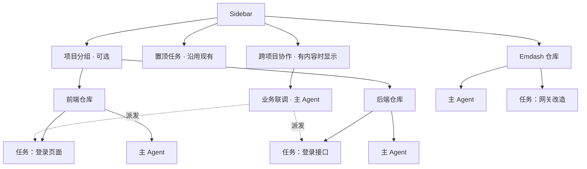
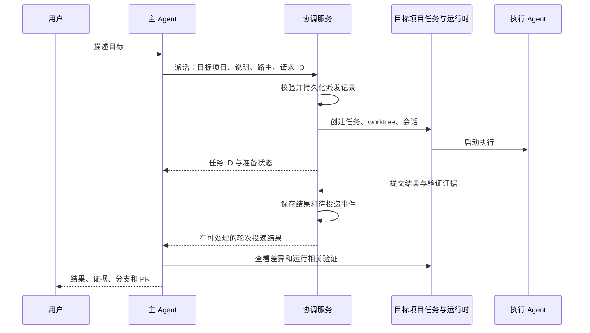

# 主 Agent 与跨仓库任务协作方案

状态：已按执行方案完成 P1–P8 的实现、真实启动隔离模拟验收及最终门禁。本文定义产品规则，具体证据和 Agent／Host 支持边界见[验收核对](main-agent-coordination-acceptance.md)；未声明所有客户端、远程能力或真实模型组合均已验证。

开发顺序、模块改动与逐步完成条件见 [执行方案](main-agent-coordination-execution.md)。

## 1. 用户要完成的事

每个项目创建后都有一个主 Agent。用户直接向它说明目标，它负责拆分任务、选择执行 Agent、跟踪结果和维护文档。执行任务继续使用 Emdash 的任务、分支和 worktree。

例如，用户在 Emdash 项目的主 Agent 中说："完善网关配置，补测试，并整理方案。" 主 Agent 创建代码任务、给任务 Agent 指令，收到结果后检查证据，把方案和结论保存在管理文档中。代码停留在各自任务分支，用户可以继续检查，也可以让主 Agent 或任务 Agent 开 PR。

同一目标涉及前端、后端和 SDK 时，主 Agent 可以直接向这些仓库派活。用户也可以创建独立的跨项目主 Agent，长期负责这些仓库的协作。两种入口使用同一种协调能力。

用户需要理解的核心对象只有主 Agent 和任务。项目继续表示已有仓库或目录，分组继续用于整理侧栏。

## 2. 已确认的产品规则

| 事项 | 规则 |
| --- | --- |
| 项目主 Agent | 每个项目创建时自动建立，固定显示在项目下面 |
| 跨项目协作 | 主 Agent 可以操作多个项目；独立跨项目入口按需创建 |
| 派活 | 复用 Emdash 任务、分支和 worktree；允许指定 Agent、供应商、模型名和 effort，省略则沿用兼容的默认配置 |
| 默认强度 | 设置中的 Agent 默认配置允许选择默认模型强度；主 Agent、普通新会话和未覆盖 effort 的派活复用同一解析规则 |
| 代码汇合 | 任务结果暂时保留在各自分支，不新增强制的集成分支或自动汇合步骤 |
| PR | 主 Agent 和任务 Agent 都能创建；目标可以是组织仓库的主分支，也可以是其他明确指定的仓库和分支 |
| 文档 | 保存在独立管理分支，可提交到自己的 fork，不进入上游代码 PR |
| 跟进上游 | 自动检查并同步到本地基线，保留任务分支；冲突或检查失败时报告 |
| MCP | 调用者所在项目只表示来源，不能作为跨项目操作的固定边界 |
| 界面 | 保留项目与任务树；项目主 Agent 位于项目内，跨项目主 Agent 有独立入口 |

本方案描述的是产品中的 PR 能力。开发本方案对应功能时，仍遵守本项目直接提交工作分支的约定，不要求创建 PR。

## 3. 范围

本次覆盖主 Agent 的创建与入口、任务派发与结果回传、跨项目 MCP、默认模型配置的复用、管理文档、PR 目标表达和上游同步。

不包含组织账号体系、多用户权限系统、独立云端调度服务、自动合并 PR、自动解决 Git 冲突、将多个任务分支自动合成一个分支，以及重新实现网关协议转换。任务费用限制、完整任务总览等已有需求另行安排。

第一条可独立验收的链路是：创建一个本地 Git 项目，进入自动生成的主 Agent，派出一个任务，在原有任务界面执行，结果可靠回到主 Agent。跨仓库、管理分支、上游同步分别在后续阶段补全；完成第一阶段不能宣称整个方案完成。

## 4. Sidebar 与页面

### 4.1 展示层级

项目展开后第一行固定为主 Agent，随后排列现有任务。主 Agent 行可以显示工作中、等待处理等状态，点击直接进入对话。点击项目名称仍进入项目页面；原有添加任务、拖动排序和置顶任务功能保留。

跨项目协作区只列出独立创建的跨项目主 Agent，不重复列出所有项目主 Agent。项目主 Agent 临时调用其他仓库时，入口仍留在原项目内；跨项目操作不要求先转换入口类型。

一个任务在所属项目下只有一个实体。主 Agent 页面中的任务列表、置顶列表和搜索结果都是这个实体的引用。项目分组的移动不会改变派活关系或 MCP 权限。

### 4.2 主 Agent 页面

默认打开对话，提供任务和文档标签。关联项目、Agent 类型、接入方式、模型以及默认派活配置放在页面设置中。

任务标签只展示这个主 Agent 派出的或明确接管的任务，包含仓库、状态、当前执行 Agent、结果和 PR 链接。点击进入已有任务工作区。跨项目任务不在左侧再复制一套树。

文档标签打开主 Agent 管理的文件，复用文件树和编辑器能力。用户不必通过一个伪装成普通开发任务的入口查找文档。

创建项目会立即建立主 Agent 记录和可见入口。启动 Agent 进程在用户首次发消息或有待处理任务事件时发生；仅添加仓库不会自行发出模型请求。没有可用 Agent 或模型配置时显示具体缺项，设置完成后继续原对话。

主 Agent 的身份和文档不依赖某一次模型会话。更换 Agent、重启会话或新开主对话后，任务关系和文档仍保留。

### 4.3 跨项目入口

创建跨项目主 Agent 时填写名称、关联项目和文档存放项目。文档存放项目默认采用发起操作的项目；没有发起项目时必须选择，不能随意猜测。

项目主 Agent 和跨项目主 Agent 可以直接指挥执行任务。不会形成跨项目主 Agent 必须先指挥各项目主 Agent、再逐层派活的流程。

一个任务同一时刻有一个负责协调的主 Agent。其他主 Agent 可以读取获准访问的结果；接管任务需要显式变更负责关系，避免同时向一个任务注入相互冲突的指令。

## 5. 从用户指令到任务结果

1. 用户向主 Agent 描述目标，主 Agent 补充任务说明：目标、相关项目、约束、依赖和验收方式。
2. 主 Agent 调用派活工具，明确目标项目，按默认值或显式配置选择执行 Agent、供应商、模型名和 effort。
3. 后台解析目标项目、代码基线、配置和执行权限，持久化派发记录，再通过任务与 workspace 生命周期创建分支、worktree 和会话。
4. 工具返回稳定的任务 ID、会话 ID 和派发状态。资源尚未就绪时返回准备中，不能把进程已启动报告为任务完成。
5. 执行 Agent 在现有任务界面工作，用户随时可以打开查看或接手。
6. 执行 Agent 提交结构化结果；后台保存结果并将事件交给主 Agent。主 Agent 正在处理用户消息时，结果进入队列，待安全的轮次边界处理。
7. 主 Agent 查看改动、检查记录和未解决问题，继续派活、请求修正或向用户交付结果。

对有依赖的任务，例如 SDK 修改完成后才能修改调用方，主 Agent 保存明确的前置任务 ID。前置结果通过检查后才启动后续任务。先支持简单依赖和阻塞原因，不增加用户必须操作的工作流编排器。

跨仓库的代码交付必须写明可消费的版本、提交或分支。仓库 A 完成并不意味着仓库 B 已经获得改动，也不意味着整体目标完成。

## 6. Agent、模型和默认路由

主 Agent 和执行 Agent 都复用现有的 Agent 选择、网关／官方登录和模型目录。主 Agent 可以使用 Claude Code，任务使用 Codex，也可以反过来。

派活参数可以覆盖 Agent 类型、接入方式、供应商、模型名和 effort（推理强度）。界面与 MCP 提供同等能力，主 Agent 可以针对不同任务使用不同组合。默认值按以下顺序解析：本次派活显式值、主 Agent 保存的派活默认值、所选 Agent 的现有有效默认值。项目或用户配置的优先级继续由原设置域解析，不再复制一份 Provider 配置。

设置中的 Agent 默认配置，在默认接入方式和默认模型旁增加“默认模型强度”。用户可以保存某个受支持的 effort，也可以选择“跟随模型／Agent 默认”。这个入口适用于主 Agent、普通新会话和派发任务，不能只在派活表单中提供临时覆盖。

默认强度与所选 Agent、接入方式和模型组合一起校验和保存。选项来自该组合支持的能力；不支持推理强度时显示原因并禁用具体值。切换模型导致已选强度失效时，要求重新选择或显式恢复默认，不静默丢弃用户设置。已有供应商或模型专用的强度配置通过原模型配置域解析，不能再建立一份互不一致的可用值目录。

effort 的有效值优先级为：本次任务／会话显式值 → 主 Agent 的派活默认值（仅派活时适用）→ 设置中的所选 Agent 默认强度 → 模型／适配器默认。只有未设置或明确选择跟随默认才继续向后解析；已保存的具体值与目标模型不兼容时返回配置错误，不用低优先级值掩盖失效配置。派活默认表单显示继承值及来源，用户可以覆盖，也可以清除覆盖。

修改设置中的默认强度后，对随后创建的会话和随后解析的派活生效。已经启动或已解析并排队的任务保留其有效配置，重试启动也使用该快照；要改现有会话须显式修改，并按适配器能力原位更新或重启。主 Agent 自身的强度与其派活默认强度分别作用于对应会话，不能互相混用。

未保存过默认强度的历史配置按“跟随模型／Agent 默认”迁移，保持原有行为。新增字段走现有设置持久化和版本迁移路径，重启后保留；字段名称和具体存储结构在实施时沿用对应设置域约定。

| 派活字段 | 含义与规则 |
| --- | --- |
| `agent` | 执行程序，例如 Claude Code 或 Codex；与模型供应商分开表达 |
| `connection` | 网关或官方登录；省略时按兼容默认配置解析 |
| `supplier_id` | 已配置模型供应商的稳定 ID；不接收临时明文 Key，也不把 Agent 插件 ID 当作供应商 ID |
| `model` | 未指定供应商的网关模式下表示公共模型别名；指定供应商时表示该供应商的模型名；官方模式下表示该 Agent 的官方模型 ID |
| `effort` | 所选 Agent、模型和协议组合支持的推理强度值；省略时继承兼容默认值或使用适配器默认 |

普通派活仍可只选公共模型别名。显式指定供应商和模型名时，为该任务建立限定到会话的网关路由，使用供应商已有地址、协议和凭据配置，不改写公共别名的全局路由。这个任务级路由是本方案需要增加的能力，不能把已有公共模型目录说成已经支持任意供应商覆盖。

指定供应商后可以从其模型目录选择，也可以填写实际模型名；不要求先创建全局别名。若不同协议的上游模型名不同，复用已配置映射；映射未知或协议能力不明确时返回待配置原因，不根据名称猜测等价模型。任务路由仍经过网关及已有协议校验和用量采集，不新建直连绕行路径。

更换 Agent、供应商或模型后只继承兼容的下游字段。只指定供应商而未指定模型时，只有该供应商有明确的有效默认模型才允许补全，否则返回缺少模型。显式选择官方登录时不接受网关供应商参数；不能把 Claude 的官方配置直接套给 Codex，也不能在配置失败时默默切换账号或模型。

effort 的可选值从插件及模型能力获取，不固定为所有 Agent 通用的枚举，也不假定相同名称的推理强度跨模型等价。适配器负责映射到 CLI 启动选项或 ACP 配置；如果经过网关转换，还要验证该路径能表达和传递这个值。显式设置不支持的 effort 时返回明确错误，不静默忽略或降级。派活的 effort 只影响目标会话，不修改主 Agent 或用户的全局默认值。

例如，主 Agent 可以给任务 A 选择 Codex、某个已配置供应商、该供应商的代码模型及其支持的高推理强度；给任务 B 使用 Claude Code、公共模型别名及另一档受支持的 effort。两个任务独立解析、记录并展示实际生效值。

持久化派发时的原始参数、解析后的 Agent、接入方式、供应商引用、模型名、effort、各字段默认值来源及配置版本。界面和工具返回有效配置，方便核对实际执行选择。凭据只保存引用。

使用公共别名的任务继续遵守已有路由变更规则：兼容时下一轮生效，不兼容时提示重启。显式供应商与模型的任务保留该绑定，不因无关公共别名调整而换供应商；供应商被停用或配置失效时明确报错。任务级配置可追溯，仍由模型与网关域统一解析和执行。

启动前验证插件能力、凭据引用、模型可用性和运行位置。远程任务不能使用桌面的 loopback 网关地址；能力不满足时，任务保留可重试状态并报告原因。

## 7. 文档、规则和任务说明

长期约束继续使用已有全局／项目规则。每个执行任务只有一份任务说明，覆盖目标、约束、进度和结果。共享上下文、交接记录不再暴露为多个并列概念。

主 Agent 维护方案、决策和验收文档。派活时附上相关内容或文档引用及版本，不把所有文档复制进每个任务分支。子 Agent 需要更多信息时，通过受控读取获取；远程任务收到内容或可访问资源引用，不能收到仅在桌面有效的本地路径。

派活的 `document_refs` 明确选择来源主 Agent、相对路径及可选版本。后台在任务准备时保存选中文档的内容和实际版本；重试、等待前置任务、接管或重启不替换这份输入。任务 Agent 可以读取附给自己的文档快照，这不会授予整个来源管理目录的访问权。读取未选文档或其他版本仍须通过项目授权；修改来源文档不追写已派任务。

每个主 Agent 有一个明确的文档存储位置。建议由文档存放项目提供专用管理 worktree，分支形如 `emdash/manage/<稳定 ID>`。不同主 Agent 分开存放，防止多个会话同时写同一个管理 checkout。

建议管理分支使用独立历史，只保存管理文档；分支创建和 worktree 注册通过 Git runtime 与 workspace registry 实现。代码任务一律从目标项目代码基线创建，不能从管理分支创建。

管理文档可以提交、推送到配置的个人 fork；没有 fork 或推送目标尚未配置时保存在本地。创建主 Agent 本身不会自动推送。管理分支不作为上游代码 PR 的来源，PR 创建入口应阻止误选。

代码仓库里本来就属于产品的 README、公开 API 文档和开发指南，仍随代码任务更新并进入相应 PR。这里集中的是主 Agent 管理的本地方案、任务资料和决策，不自动搬走上游已有文档。

对于尚无提交的 Git 仓库，先保存协调记录，等代码基线建立后开放分支派活。非 Git 目录项目也有主 Agent 入口，但管理分支、PR 和基线同步显示不适用；Git 文档存储可以另选一个关联仓库，不自动初始化或改变原目录。

## 8. Git 分支、PR 与上游同步

### 8.1 分支职责

| 类型 | 用途 | 自动行为 |
| --- | --- | --- |
| 项目代码基线 | 跟随配置的上游代码分支，为新任务提供起点 | 检查后只做安全的快进同步 |
| 管理分支 | 主 Agent 的本地文档 | 独立保存，不参与代码基线同步 |
| 任务分支 | 某个任务的代码改动 | 创建后保留；不随基线更新自动 rebase 或合并 |

基线由目标项目的 `defaultBranch`、`baseRemote` 等配置确定。没有充分配置时显示待设置，不假定分支一定叫 `main`，也不把 `origin` 固定视为上游。

### 8.2 PR

PR 操作明确携带源项目、源分支、推送远端、目标仓库和目标分支。默认值来自对应项目的 Git 配置，实际创建结果返回 PR URL 和目标，供主 Agent 汇总。

例如：任务代码推送到个人 fork 的 `feat/login`，PR 指向组织仓库的 `main`。PR 合并后，本地代码基线跟随组织仓库同步。主 Agent 的管理分支与这个 PR 无关。

主 Agent 可以为自己负责的任务创建 PR，任务 Agent 也可以为自己的任务创建。授权内重复请求应返回已存在的对应 PR；有歧义时报告候选，不再创建一条。

创建 PR 不等于允许合并。自动合并、强制推送和改写现有任务历史不在本方案范围内。

### 8.3 自动检查与同步

建议触发点是项目接入或恢复连接、准备从基线创建任务，以及已有 PR 集成观察到相关 PR 合并。合并重复触发，对同一仓库串行执行；不新增持续请求 GitHub 的轮询循环。界面展示上次检查时间，离线期间不声称基线已跟上上游。

同步顺序：解析上游和基线、fetch、检查分叉及工作区状态、执行允许的快进、刷新 Git live model。配置了项目验证命令时执行该命令并记录结果；没有配置时仅报告 Git 同步成功，不能声称项目测试通过。

只有本地基线是目标上游祖先且相关 checkout 可安全更新时才快进。基线被其他工作区使用、有未提交内容、本地分叉或远端被改写时，停止写入并报告具体状态。不得通过直接改 ref 绕过已检出的工作区。

同步后的检查失败要记录前后提交和失败输出，暂停以该基线继续自动派活，保留任务分支。是否恢复基线由显式操作决定，不静默硬重置。网络暂时不可用时可以使用已有本地基线，但任务记录要标记最后检查时间和离线状态；从未建立过有效基线则阻止创建。

自动同步仅更新本地基线。将个人 fork 的远端主分支推送到同一提交，可以作为明确的项目选项；默认不随本地同步隐式推送。

## 9. MCP 接口与权限

### 9.1 调用者和目标分离

保留每个会话的调用身份验证。调用者身份用于授权和追溯，目标通过稳定 ID 指定，不能通过修改项目名称或传入任意路径绕过目标检查。

个人使用模式下，建议主 Agent 默认可以发现并操作本 Emdash 已接入且可访问的项目，设置中可以收窄到指定项目。关联项目用于组织上下文和结果，不等同于完整权限列表。执行 Agent 默认获得自己的任务，以及完成任务需要的明确跨项目权限；主 Agent 可在已有授权范围内授予，不能扩大自身权限。

在已授权范围内，常规派活和发消息不再每次弹窗打断。终端授权、删除项目、强制 Git 操作等保留各自机制。MCP 权限不被描述为对原生 Agent shell 的操作系统沙箱。

### 9.2 建议工具契约

下表是需要达到的接口行为；实施时优先扩展已有工具，避免功能相同的平行 API。

| 能力 | 关键输入 | 输出与规则 |
| --- | --- | --- |
| 发现项目 | 可选查询 | 允许访问的项目 ID、host、可用状态、基线摘要 |
| 列出任务／会话 | 可选 `project_id`、协调者或任务过滤条件 | 仅返回获准访问的数据；跨项目范围须显式表达 |
| 创建任务 | `project_id?`、名称、任务说明、`base_branch?`、`depends_on?`、`document_refs?`、`agent?`、`connection?`、`supplier_id?`、`model?`、`effort?`、`request_id` | 返回稳定任务 ID、会话 ID、准备状态和解析后的有效配置 |
| 发消息 | `conversation_id`、文本、`request_id` | 验证目标身份和权限，返回已排队／已投递状态 |
| 获取任务状态 | `task_id` | 运行状态、等待原因、负责关系、最新结果版本 |
| 取消等待任务 | `task_id` | 当前负责的主 Agent 取消尚未获准启动的任务，保留记录；不停止运行中的任务 |
| 提交结果 | `task_id`、摘要、提交引用、验证证据、未解决项、`request_id` | 幂等保存结果并通知负责的主 Agent |
| 读取管理文档 | 协调者 ID、相对路径、可选版本 | 校验权限与路径，返回内容和版本 |
| PR 操作 | 源任务、源分支、目标仓库与分支 | 复用 PR 服务，返回明确目标和链接 |

`project_id` 省略时沿用调用者的所属项目。跨项目主 Agent 的文档存放项目仅作为兼容调用来源，不作为多仓库派活的隐式业务选择；它发起派活时应显式填目标项目。

创建代码任务的默认基线统一来自目标项目。需要基于另一个任务继续开发时显式传 `base_branch`，不再无条件继承调用者分支。这个行为变化必须更新工具说明、调用方和测试。

未知项目、权限不足、目标归档、host 离线、模型不兼容分别返回可识别的错误。不会把失败的跨项目请求退回调用者项目执行。

## 10. 持久状态与服务边界

### 10.1 复用运行时，显式表示角色

建议增加协调者记录，保存稳定 ID、名称、入口类型、所属项目、关联项目、文档位置、主会话引用和派活默认值。项目默认主 Agent 的绑定应有唯一约束，重复事件和恢复重试不会多建入口。

为了复用会话、workspace、PTY／ACP 和调用者解析，协调者可以绑定一个具有显式 `coordination` 类型的任务运行容器。它在界面投影为主 Agent，不通过特殊名称识别，也不混进普通代码任务数量、默认 `list_tasks` 或普通任务完成流程。其归档／删除由协调者生命周期管理。

具体表名和字段由迁移实现决定。至少需要持久化以下关系和事实：

| 数据 | 所有者与约束 |
| --- | --- |
| 主 Agent 及项目默认绑定 | 协调域；项目默认绑定唯一 |
| 关联项目、文档存放位置 | 协调域；项目移除后保留明确失效状态 |
| 任务负责关系、依赖和任务说明 | 协调域；一个任务一个负责者，任务说明单一来源 |
| 任务、分支、workspace、会话 | 复用任务、workspace registry、Git 和会话域 |
| 派发请求与有效路由 | 协调域记录请求、解析结果和默认值来源；模型与网关域拥有任务路由；调用者加 `request_id` 唯一，相同 ID 不允许不同参数 |
| 结果与待投递事件 | 协调域；结果版本稳定，事件可恢复并去重 |
| 基线同步状态 | Git／项目域；按仓库记录最后检查、提交和失败 |
| 文档正文 | 管理 worktree；数据库只保存引用和必要的版本信息 |

任务或会话启动涉及数据库之外的进程和文件操作，不能声称一个数据库事务覆盖全部过程。持久化执行步骤及稳定资源 ID，恢复时检查资源是否已创建，再继续下一步。

### 10.2 后台负责执行

主 Agent 的创建、派活、会话启动、结果保存和事件投递由主进程服务及对应 host runtime 完成。Renderer 订阅 typed live model 和事件，负责展示及必要的用户交互。

需要从现有 renderer 操作中提取可复用的任务创建与会话启动能力。不能在后台模拟点击，也不能要求目标项目必须先在窗口中打开。涉及远程 host 的文件和 Git 操作通过该 host 的运行时执行。

推荐在 `src/core/features/coordination/` 建立拥有协调状态的 slice，`agent-control` 只处理 MCP 身份与调用适配。项目创建后发出事件，由协调服务幂等建立默认主 Agent；启动恢复补齐因中断遗漏的绑定。Wire 契约、controller、视图和命令使用现有 manifests 注册。

关闭或切换页面不会丢失派发和结果。关闭窗口后，只要 Emdash 后台进程仍在运行且 Agent 适配器支持相应执行，任务可继续。应用完全退出或机器休眠时不承诺持续执行；重启后对照运行时恢复或报告中断，不能重复启动未知状态的任务。

### 10.3 结果和事件

执行结果至少包括摘要、分支／提交引用、变更范围、验证命令及结果、未解决项和可选 PR。日志、退出码和代码差异是可核验依据，模型声称成功只是提交的结果内容。

任务现有生命周期继续保留。协调域只增加准备、运行、待检查、阻塞等执行观测和结果，不另建一套与任务状态相互矛盾的完成按钮。执行 Agent 提交结果后进入待检查；主 Agent 或用户检查后才可将任务置为完成。

检查针对一个明确的结果版本。同一版本只保存一个检查决定，相同决定及说明可幂等重试；另一个窗口或会话提交不同决定时报告冲突并刷新。要求修改后，执行 Agent 提交下一版结果，再进行检查，不能用过期的接受请求覆盖已保存的修改意见。

Agent 空闲、终端退出、PR 创建成功都不能单独判定任务完成。未提交结构化结果就退出时，记录中断或待检查，允许恢复。

投递使用持久事件队列，采用可重试投递和消费去重，不声称跨进程严格只投递一次。主 Agent 忙时按队列交付，用户消息优先，不直接往正在输入的终端写结果。PTY 路径若无法确认投递，保留待处理状态，不能把字节写入当作已消费。

不支持可靠返回和恢复的 Agent 适配器应明确标示限制；不能只因支持 PTY 就标为完整自动协调能力。首批以可自动化验收的 Claude Code 和 Codex 路径建立能力矩阵。

## 11. 代码依据与改动位置

以下是制定方案时核对的实现与改造位置。当前实现状态和验收证据见执行方案，不能把这份最初的改造清单当作未完成项。路径相对仓库根目录。

| 实现位置 | 已有行为 | 本方案所需变化 |
| --- | --- | --- |
| `apps/emdash-desktop/src/core/features/workbench/browser/sidebar/left-sidebar.tsx`、`sidebar-store.ts` | 置顶、项目分组、项目和任务列表 | 增加项目主 Agent 固定行及按需出现的跨项目入口，保留排序与虚拟列表 |
| `apps/emdash-desktop/src/core/features/tasks/browser/view/task-sidebar.tsx` | 任务内对话、文件和改动面板 | 复用对应能力承载主 Agent 页面，任务页面行为保留 |
| `apps/emdash-desktop/src/core/features/projects/node/operations/create-project.ts` | 注册项目和 workspace，项目事件驱动后续处理 | 幂等建立默认主 Agent，失败可恢复，不能让重复事件创建多个实例 |
| `apps/emdash-desktop/src/core/features/agent-control/node/mcp-tools.ts` | 提供任务、会话和消息工具 | 明确目标项目、统一路由输入、结果工具、幂等请求 |
| `apps/emdash-desktop/src/core/features/agent-control/browser/execute-agent-action.ts` | 使用调用者项目的前端 store 创建任务；默认继承调用者分支；操作弹窗确认 | 抽取后台执行链；目标项目基线；已授权派活无需逐次确认 |
| `apps/emdash-desktop/src/core/features/agent-control/node/agent-control-dispatcher.ts` | 选择活跃 renderer 执行，无窗口时报错 | 自动协调操作交给后台服务；需要展示和交互的操作保留 renderer 调度 |
| `apps/emdash-desktop/src/core/features/agent-control/node/resolve-caller.ts` | 根据会话、任务、项目解析调用者 | 保持身份验证，增加协调角色和能力解析，分离调用来源与目标 |
| `apps/emdash-desktop/src/core/primitives/tasks/api/task-config.ts` | 初始会话已有 Agent、模型和接入字段 | 复用有效配置字段，补充角色与关系所需版本化数据 |
| `packages/core/src/runtimes/git/` | 按仓库统一串行 Git 操作，拥有 checkout 和 refs 状态 | 管理分支、基线快进和 PR 前置检查走同一运行时 |

数据库变更按 Drizzle 生成迁移，并更新 fixtures 和迁移测试。涉及 PTY、SSH 和数据库实现时，先读取对应风险文档。不会新增直接 renderer-main IPC 或绕开现有进程环境构建路径。

## 12. 失败、兼容与恢复

| 情况 | 行为 |
| --- | --- |
| 默认主 Agent 初始化中断 | 项目保留可用，主 Agent 行显示准备失败；按同一稳定 ID 重试 |
| 重复派发请求 | 返回同一任务和当前状态；参数不同则报冲突 |
| worktree 已创建但会话未启动 | 恢复会话启动步骤，保留分支，不重复创建任务 |
| 任务结果到达时主 Agent 未启动 | 结果入库，满足自动处理条件时启动；缺配置时提示待处理 |
| 主 Agent 会话崩溃 | 保留协调身份、说明、结果和事件，按适配器恢复能力恢复 |
| 子任务阻塞或取消 | 上报原因；依赖任务保持等待，取消不等于完成 |
| 多窗口同时操作 | 后台唯一约束和幂等请求决定结果，窗口不持有唯一执行权 |
| 项目归档 | 隐藏入口并停止新增自动派活；保留任务和文档，恢复时不重复创建 |
| 删除文档存放项目 | 提示依赖并要求先迁移文档位置或明确处理关联主 Agent，沿用删除确认 |
| 移除关联项目 | 保留历史任务引用，不删除仓库或分支；停止新增派活 |
| 不支持的远程能力 | 返回具体缺项，保留记录；不改成本地执行或切换认证 |

已有项目首次加载协调功能时补齐默认主 Agent 记录，实际工作区资源按需准备，避免升级立即为全部仓库拉取或启动 Agent。已有任务不会自动挂到某个主 Agent，用户或主 Agent 可以显式接管。

关闭协调功能后，普通任务和分支仍可使用；停止新的协调调度，保留记录和管理文档。数据库回退按项目既有迁移策略处理，不承诺旧版本可以读取增加了角色类型的数据。

## 13. 分阶段实施

| 阶段 | 交付内容 | 完成证据 |
| --- | --- | --- |
| 1. 单项目闭环 | 协调身份、后台任务创建和会话启动、项目主 Agent 入口、设置中的默认强度、默认及显式供应商／模型／effort、结果保存和回传 | 临时仓库中从项目创建到派活、执行、检查结果可完整运行；切换页面不影响任务 |
| 2. 跨项目协作 | 显式目标项目、权限范围、独立跨项目入口、任务归属与依赖 | 一个主 Agent 向两个仓库派活，结果返回同一对话；越权和错误目标被拒绝 |
| 3. 管理文档 | 独立管理分支与 worktree、文档标签、版本化上下文读取 | 文档可编辑和恢复；代码任务与 PR 差异不包含管理文档 |
| 4. Git 协作 | PR 源／目标明确化、本地基线同步、冲突和验证失败处理 | fork／上游模拟仓库验收；任务分支提交不被同步过程改写 |
| 5. 恢复与覆盖验收 | 崩溃恢复、多窗口、已有项目迁移、可支持的远程路径及 Agent 能力标注 | 故障注入和界面验收通过，记录实际支持范围及未覆盖组合 |

阶段 1 就建立后续所需的目标项目字段、幂等 ID 和持久事件边界，阶段 2 再开放跨项目交互；不会先实现一套只能依赖当前窗口的临时协调器。

阶段 1 至 2 可先使用注册的临时管理目录承载主会话，文档功能保持未开放；阶段 3 将其迁移到管理分支并验证内容，不把临时目录称为已完成的持久文档方案。

功能开发提交可以按阶段完成。完整方案交付需要全部阶段完成，并说明远程与 Agent 组合的实际覆盖范围。没有发布或打包授权时，不触发发布流程。

## 14. 验收计划

验收由开发 Agent 在临时仓库、隔离数据库和独立应用配置中执行，不使用生产数据库，不要求用户代替执行。测试命令使用当前会话终端，不走需要用户授权的 Emdash terminal。

| 场景 | 方法与判定 |
| --- | --- |
| 项目默认入口 | 创建和恢复同一项目，始终只有一个主 Agent；不因创建项目产生模型请求 |
| 现有侧栏兼容 | 浏览器测试覆盖分组、折叠、置顶、虚拟滚动和主 Agent 行定位 |
| 单项目派活 | 实际临时 Git 仓库创建任务和 worktree，执行结果回到主 Agent |
| 跨仓库 | 两个独立仓库、两个任务，只对应各自分支，主 Agent 汇总两个结果 |
| 路由 | 默认与显式供应商、模型名都传到真实请求；任务级覆盖不改变公共别名或其他会话；不兼容选择报错，禁止静默回退 |
| effort | 验证显式值、兼容默认值、CLI／ACP 配置和转换后的请求；不支持时明确报错，不丢弃、不静默降级 |
| 默认强度设置 | 保存后重启仍保留；普通新会话、主 Agent 和无覆盖派活使用同一默认；逐层覆盖和恢复默认正确；切换模型校验失效值；修改默认不改写运行中或已排队任务；历史空值保持原行为 |
| 基线选择 | 主 Agent 位于管理分支时，任务仍从目标代码基线创建；显式基线覆盖有效 |
| 文档隔离 | 管理分支含文档，任务相对上游的差异不含管理文档；重启后文档位置不变 |
| 幂等与恢复 | 在资源创建、启动和结果投递之间注入中断，重启无重复任务或结果处理 |
| 前台独立 | 切换页面、关闭 renderer 后按运行条件继续；重开界面能看到真实状态 |
| 任务完成语义 | 进程启动、空闲、退出和 PR 打开均不能误报完成；缺证据保留待检查 |
| Git 同步 | 临时 bare 上游和 fork 覆盖快进、分叉、脏工作区、已检出基线及检查失败 |
| PR 目标 | 服务契约测试核对源与组织目标；不向真实组织仓库创建测试 PR |
| 权限与路径 | 可授权跨项目访问，拒绝伪造调用者、超范围目标和文档路径越界 |
| 远程 | 可用隔离 host 验证任务目标、文档内容交付和重连；没有环境时明确未验收，不以 mock 冒充 |

协议和服务测试使用可控 Agent／上游替身；真实 CLI 与支持的会话路径另做隔离集成验收，记录版本与结果。mock PR 测试只能证明请求契约，真实平台发布能力是否验收要单列，不混称端到端通过。

开发过程运行相关测试，涉及数据库时完成 fixtures 与迁移测试；交付前按改动范围执行仓库规定的 format、lint、typecheck 和 test。本文定义验收标准，实际通过项及证据以执行方案中的实施记录为准，不能把计划中的检查视为已经通过。
